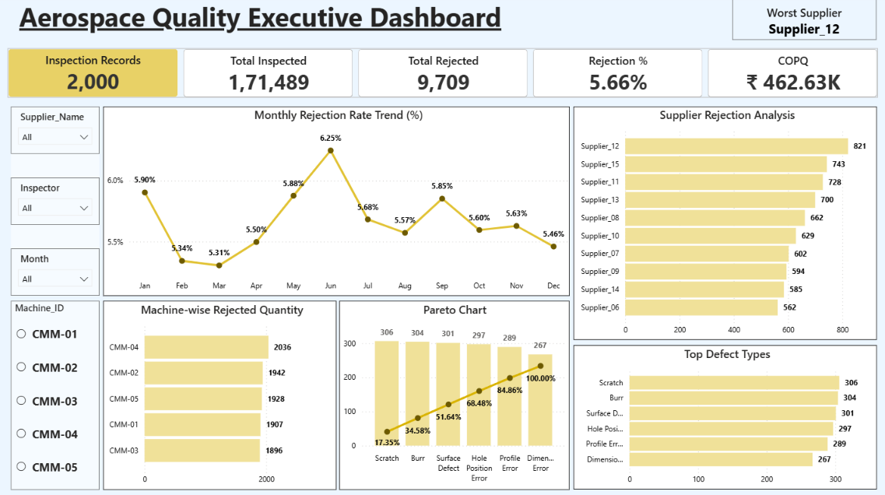

# Manufacturing Quality Analytics

An end-to-end data analytics portfolio project using Python, MySQL, and Power BI to analyze manufacturing inspection data, rejection patterns, supplier performance, machine-level quality, and Cost of Poor Quality (COPQ).

The project demonstrates how manufacturing quality data can be transformed into actionable insights through data analysis, SQL queries, and an interactive Power BI dashboard.

## Project Overview

Manufacturing organizations need reliable quality data to monitor inspection performance, identify recurring defects, evaluate supplier quality, and control rejection costs.

This project analyzes a practice dataset to demonstrate how data analytics can support quality monitoring and decision-making in a manufacturing environment.

## Business Objectives

* Monitor inspection and rejection performance.
* Analyze monthly rejection-rate trends.
* Identify suppliers with high rejected quantities.
* Examine machine-wise rejection quantities.
* Identify frequent defect types.
* Analyze rejection costs and their contribution to overall quality costs.
* Present quality performance through an executive dashboard.

## Tools and Technologies

| Tool             | Application                                 |
| ---------------- | ------------------------------------------- |
| Python           | Data inspection, cleaning, and analysis     |
| Pandas           | Data manipulation and transformation        |
| MySQL            | SQL-based analysis and aggregation          |
| Power BI         | Interactive dashboard and KPI visualization |
| Jupyter Notebook | Python analysis workflow                    |

## Key Performance Indicators

The following results were obtained from the practice dataset and validated during SQL analysis.

| KPI                         |      Result |
| --------------------------- | ----------: |
| Inspection Records          |       2,000 |
| Total Inspected Quantity    |     171,489 |
| Total Rejected Quantity     |       9,709 |
| Overall Rejection Rate      |       5.66% |
| Total Rejection Cost (COPQ) | ₹462,632.32 |

### Metric Definitions

* **Inspection Records:** Number of records in the inspection dataset.
* **Total Inspected Quantity:** Sum of `Qty_Inspected`.
* **Total Rejected Quantity:** Sum of `Qty_Rejected`.
* **Overall Rejection Rate:** Total rejected quantity divided by total inspected quantity, multiplied by 100.
* **COPQ:** Sum of `Rejection_Cost`, representing rejection-related costs in the practice dataset.

These figures describe the practice dataset and should not be interpreted as actual company performance.

## Power BI Dashboard

The Aerospace Quality Executive Dashboard provides a consolidated view of manufacturing quality performance.

Dashboard components include:

* Executive KPI cards for inspection records, inspected quantity, rejected quantity, rejection rate, and COPQ.
* Monthly rejection-rate trend.
* Supplier rejection analysis.
* Machine-wise rejected quantity.
* Defect Pareto analysis.
* Top defect types.
* Supplier, inspector, month, and machine filters.
* Worst-supplier indicator.

The dashboard is designed to help users explore quality performance and identify areas that may require further investigation.

## Power BI Dashboard Preview

The Aerospace Quality Executive Dashboard provides an overview of manufacturing quality performance through key performance indicators (KPIs), rejection trends, supplier analysis, machine-wise rejection analysis, and defect Pareto analysis.



### Key Performance Indicators

| KPI                         |       Value |
| --------------------------- | ----------: |
| Inspection Records          |       2,000 |
| Total Inspected             |     171,489 |
| Total Rejected              |       9,709 |
| Rejection Rate              |       5.66% |
| Cost of Poor Quality (COPQ) | ₹462,632.32 |
| Worst Supplier              | Supplier_12 |

### Dashboard Components

* **Monthly Rejection Rate Trend:** Tracks monthly rejection rates to identify fluctuations in quality performance.
* **Supplier Rejection Analysis:** Compares supplier-wise rejected quantities to identify suppliers requiring further investigation.
* **Machine-wise Rejected Quantity:** Compares rejected quantities across inspection machines.
* **Pareto Analysis:** Ranks defect types by count and displays their cumulative percentage to highlight the most significant defect categories.
* **Top Defect Types:** Highlights the defect categories with the highest rejection counts.

### Interactive Filters

The dashboard includes the following slicers for exploring the data:

* Supplier Name
* Inspector
* Month
* Machine ID

These filters allow users to investigate quality performance across different suppliers, inspectors, months, and machines.

## SQL Analysis

The SQL analysis covers:

* Inspection data completeness and overall KPIs.
* Monthly inspection and rejection trends.
* Supplier-wise rejection quantities and costs.
* Defect-type analysis.
* Machine-wise rejection analysis.
* Machine and defect combinations.
* Top defect types by machine.
* Rejection cost contribution by machine.
* Final KPI validation.

The SQL queries use aggregation, grouping, conditional calculations, common table expressions, and window functions where appropriate.

## Python Analysis

The Jupyter Notebook supports the initial data-analysis workflow, including:

* Data inspection.
* Missing-value review.
* Date parsing.
* Feature creation.
* Summary calculations.
* Preparation of data for further analysis.

## Repository Structure

```text
manufacturing-quality-analytics/
│
├── README.md
├── .env.example
├── .gitignore
├── dashboard_documentation.md
├── quality_analysis.ipynb
└── quality_analysis.sql
```

The structure above reflects the files currently visible in the repository. Add the Power BI `.pbix` file and dashboard screenshot if they are not already included.

## How to Run the Project

### 1. Python

* Install Python and Jupyter Notebook.
* Install the required Python libraries.
* Obtain the practice dataset used for this project.
* Place the dataset in the notebook's expected working directory.
* Review the notebook's configuration and run the analysis cells.

The notebook currently expects a CSV file named `inspection_data.csv`. Adjust the path if necessary.

### 2. MySQL

* Create a database named `aerospace_quality`, or update the SQL script to use your own database.
* Load the inspection dataset into a table named `inspection_data`.
* Review the table structure and column names.
* Execute the queries in `quality_analysis.sql`.
* Compare the calculated totals and percentages against the source data.

### 3. Power BI

* Open the Power BI report if the `.pbix` file is included.
* Review the data source configuration.
* Refresh the data if required.
* Interact with the filters and visuals to analyze inspection performance.

## Data Privacy and Limitations

This project uses practice data for learning and portfolio demonstration.

The results illustrate an analytical workflow and should not be interpreted as verified findings from a real manufacturing organization.

When adapting this project for other datasets, verify column definitions, units, cost assumptions, and metric calculations before drawing business conclusions.

## Skills Demonstrated

* Data cleaning and exploratory analysis.
* SQL aggregation and analytical queries.
* Manufacturing quality KPI analysis.
* Supplier and machine performance analysis.
* Defect and rejection analysis.
* Rejection cost analysis.
* Power BI dashboard development.
* Data-driven quality monitoring.

## Author

**Shanmuganathan A R**

Manufacturing Quality Professional | Aspiring Data Analyst

Technical interests: SQL, Python, Excel, Power BI, Manufacturing Analytics, and Quality Analytics.
